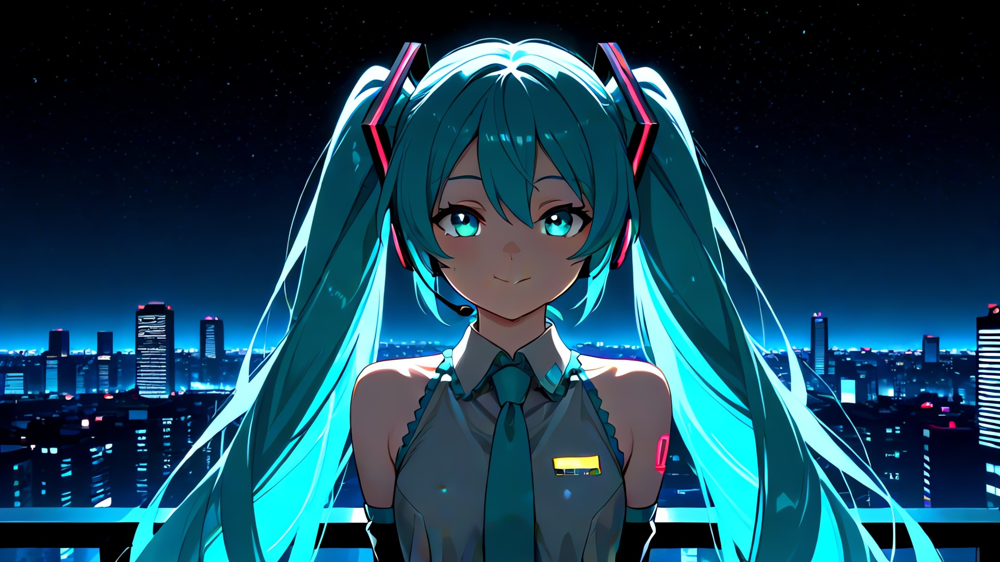
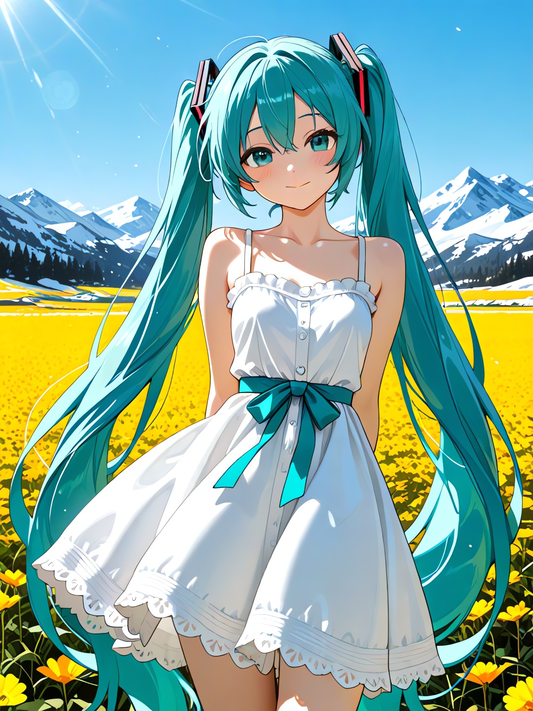
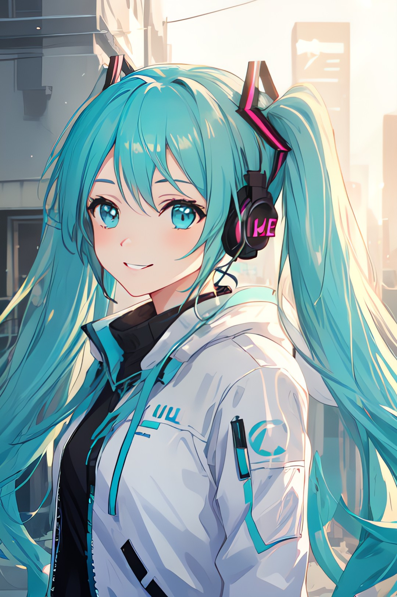

<p align="center"></p>

# GarlicDiffusion

**Native Stable Diffusion 1.5, SDXL & Real-ESRGAN 1080p/4K AI Upscaling running directly on a PlayStation 4 or PS4 Pro GPU. 100% offline, no PC required.**

[Website](https://djtomato.github.io/GarlicDiffusion/) · [Scenic Gallery](https://djtomato.github.io/GarlicDiffusion/scenic.html) · [Technical Benchmarks](https://djtomato.github.io/GarlicDiffusion/benchmarks.html) · [Download PKG](https://github.com/DJTOMATO/GarlicDiffusion/releases/latest) · [Models (Hugging Face)](https://huggingface.co/DJTomato/ps4-diffusion-models) · [Support on Ko-fi](https://ko-fi.com/djtomato) · [Community & Discord](https://discord.gg/Gbyq3kpGjc)

---

## Real PS4 Pro Outputs (100% Console-Generated)

Every image below was rendered and AI-upscaled **100% locally on a PS4 Pro (FW 11.00, Neo Mode)** in **Quiet (20 CU)** or **Silent (14 CU)** mode, with standard Automatic1111 PNG Info metadata embedded inside every file:

| WAI-Illustrious v17 DMD2 · 16:9 Full HD `1920×1080` · CFG 1.4 · Quiet (20 CU) · **77.03s** | MeinaMix V11 8-Step · 16:9 Full HD `1890×1080` · CFG 3.5 · Quiet (20 CU) · **56.90s** |
| :---: | :---: |
|  |  |

| WAI-Illustrious v17 DMD2 · `1080×1440` · **98.28s** | MeinaMix V11 8-Step · `1080×1620` · **46.47s** | Anything V5 · `1080×1620` · **88.37s** | DreamShaper 8 · `1080×1620` · **88.33s** |
| :---: | :---: | :---: | :---: |
|  |  |  |  |

> Browse all **40+ generated samples** across characters and landscapes on the [**Main Showcase**](https://djtomato.github.io/GarlicDiffusion/), [**Scenic Gallery**](https://djtomato.github.io/GarlicDiffusion/scenic.html), and [**Quality Tier Comparison**](https://djtomato.github.io/GarlicDiffusion/benchmarks.html).

---

## What It Does

| Feature | Details |
|---|---|
| **Dual SD 1.5 & SDXL GCN Engine** | 22 custom zero-scratch OpenCL GCN (`gfx701`) compute kernels dispatched via hand-written PM4 command buffers. Supports **LCM**, **Euler**, **Euler a**, and **DPM++ 2M Karras** samplers plus A1111 `(tag:weight)` prompt weighting in **SD 1.5** (`~1.5–1.7 GiB`) and **SDXL** (`~4.0–4.2 GiB`). |
| **Base PS4, PS4 Slim & PS4 Pro Neo** | Full **PS4 Pro Neo** mode (36 CUs, `4.67 GiB` GPU pool, up to `1024×1024`) and **Base / Slim PS4** support (18 CUs, automatic `325 MiB` compact scratch & `24×24` VAE tiles so both SD 1.5 and SDXL fit!). |
| **Built-In 1080p & 4K AI Upscaler** | Bundled **Real-ESRGAN AnimeVideo v3** (`SRVGGNetCompact`, 2.4 MiB) runs natively on the PS4 GPU — turning `512×768 → 1080×1620` in **8.19s**, `1024×576 → 1920×1080` in **12.04s**, or up to **4K UHD (`3840×2160`)** on PS4 Pro. |
| **Hardware CU Thermal Scaling** | 4 live power profiles (`Silent 14CU`, `Quiet 20CU`, `Balanced 25CU`, `Turbo 36CU` on Pro; `7 / 11 / 14 / 18 CU` on Base PS4) using symmetric checkerboard `SH_STATIC_THREAD_MGMT` masks + inter-block breathers to keep your PS4 cool and quiet. |
| **80+ Built-In Presets, Styles & Characters** | Ships with **20 Saved Prompt Presets**, **22 reusable Art Styles** (*Makoto Shinkai Scenic*, *Studio Ghibli*, *2D Anime Fix for DreamShaper*, *Monochrome Manga*, *Ukiyo-e*, etc.), and **38 Character Presets** (*Hatsune Miku*, *Frieren*, *Rem*, *Saber*, *Asuka*, *Hololive*, *Genshin*, *FFVII*, *Zelda*, etc.) on both TV and Web UI. |
| **Garlic LLM Visual Theme & QR Support** | Anti-aliased Selawik typography, 3D Garlic Bulb branding, royal-blue prompt bubbles, PlayStation controller footer bar, and built-in scannable **QR Codes** (`Ko-fi`, `Discord / Community`, `GitHub`, `Hugging Face`) on both TV (`[Circle]`) and Web UI (**Credits & QR** tab). |
| **1-Click Hugging Face Downloader** | Stream pre-converted `PSD1` checkpoints directly onto `/data/garlic-diffusion/models/` over PS4 HTTPS (`libSceHttp` + `libSceSsl`) with resume support and live MB/s progress. |
| **A1111 Metadata, Web Studio & Discord API** | Full LAN Web Studio on port `8081`, standard Automatic1111 `tEXt` `"parameters"` chunk inside every PNG, plus `/sdapi/v1/txt2img` (works with [`zhaobenny/bz-cogs/aimage`](https://github.com/zhaobenny/bz-cogs/tree/main/aimage) Discord bots) and OpenAI `/v1/images/generations`. |

---

## Hardware Benchmarks (Measured on PS4 Pro Neo, FW 11.00)

### 1. Speed & Quality Tiers at a Glance (`Quiet Mode · 20 of 36 CUs · ~58% GPU Power`)

| Quality Tier | Resolution → Output | Steps / CFG / Sampler | SD 1.5 (`MeinaMix 8-Step`) | SDXL (`WAI-Illustrious v17 DMD2`) | Use Case |
|---|---|---|---:|---:|---|
| **⚡ Fast Draft** | `512×512` (Native) | 4 steps · `Euler` / `LCM` | **17.28s** (`6.73s` UNet) | **17.66s** (`5.67s` UNet) | Quick composition & seed scouting |
| **⚖️ Mid Balanced** | `512×512` / `768×768` (Native) | 8 / 6 steps · Native | **26.20s** (`13.46s` UNet) | **39.92s** (`19.55s` UNet) | Fast clean square illustrations |
| **🎯 Portrait Native** | `512×768` / `768×1024` (Native) | 8 / 6 steps · Native | **38.29s** (`22.74s` UNet) | **50.78s** (`26.60s` UNet) | Standard portrait without upscaler |
| **🖥️ 16:9 Full HD** | `896×512` / `1024×576 → 1920×1080` | 8 / 6 steps + **1080p AI Up** | **55.96s** (`9.36s` Upscale) | **50.94s** (`12.04s` Upscale) | Widescreen desktop & TV wallpapers |
| **✨ Crisp 1080p HD** | `512×768 → 1080×1620` / `768×1024 → 1080×1440` | 8 / 6 steps + **1080p AI Up** | **46.47s** (`8.19s` Upscale) | **67.59s** (`16.84s` Upscale) | Flagship 1080p portrait quality |
| **💎 Ultra Detail** | `512×768` (12 stp) / `1024×1024 → 1080×1080` (8 stp) | 12 / 8 steps + **1080p AI Up** | **60.08s** (`34.11s` UNet) | **102.37s** (`50.06s` UNet) | Maximum fine detail & linework |
| **🐢 Standard 20-Step** | `512×768 → 1080p` / `768×1024` (Non-DMD2) | 20 steps · CFG 7.0 · `Euler a` | **87.17s** (`Anything V5` / `DreamShaper 8`) | **227.98s** (Non-DMD2 baseline) | Shows why DMD2 6-step is **4.5× faster** |

### 2. Full Model × Resolution × Framing × Power Mode Matrix

| Model | Arch | Framing | Gen → Output | Settings | Power Mode | UNet GPU | TFLOPS | VAE | AI Upscale | Thermal Rest | **Total Time** | GPU RAM |
|---|---|---|---|---|---|---:|---:|---:|---:|---:|---:|---:|
| **MeinaMix V11 8-Step** | SD 1.5 | Square Draft | `512×512` | 4 stp · CFG 3.0 · `Euler` | Quiet (20 CU) | 6.73s | 0.95 TF | 8.26s | — | 2.28s | **17.28s** | 1,713 MiB |
| **WAI-Illustrious v17 DMD2** | SDXL | Square Draft | `512×512` | 4 stp · CFG 1.0 · `LCM` | Quiet (20 CU) | 5.67s | 1.12 TF | 8.62s | — | 3.60s | **17.66s** | 4,208 MiB |
| **MeinaMix V11 8-Step** | SD 1.5 | Square Mid | `512×512` | 8 stp · CFG 3.5 · `Euler` | Quiet (20 CU) | 13.46s | 0.95 TF | 8.27s | — | 4.20s | **26.20s** | 1,713 MiB |
| **WAI-Illustrious v17 DMD2** | SDXL | Square Mid | `768×768` | 6 stp · CFG 1.0 · `LCM` | Quiet (20 CU) | 19.55s | 1.12 TF | 15.32s | — | 5.60s | **39.92s** | 4,208 MiB |
| **DreamShaper 8** | SD 1.5 | Square Mid | `512×512` | 15 stp · CFG 7.0 · `Euler a` | Quiet (20 CU) | 25.25s | 0.95 TF | 8.26s | — | 7.56s | **41.75s** | 1,713 MiB |
| **MeinaMix V11 8-Step** | SD 1.5 | Half / Full Body | `512×768 → 1080×1620` | 8 stp · CFG 3.5 · `Euler` | Quiet (20 CU) | 22.74s | 0.91 TF | 11.01s | **8.19s** | 5.72s | **46.47s** | 1,713 MiB |
| **WAI-Illustrious v17 / v14 DMD2** | SDXL | Half Body | `768×1024` | 6 stp · CFG 1.0 · `LCM` | Quiet (20 CU) | 26.60s | 1.11 TF | 19.18s | — | 5.92s | **50.78s** | 4,208 MiB |
| **WAI-Illustrious v17 / v14 DMD2** | SDXL | **16:9 Full HD** | `1024×576 → 1920×1080` | 6 stp · CFG 1.0 · `LCM` | Quiet (20 CU) | 19.56s | 1.12 TF | 14.37s | **12.04s** | 9.12s | **50.94s** | 4,208 MiB |
| **MeinaMix V11 8-Step** | SD 1.5 | **16:9 Full HD** | `896×512 → 1890×1080` | 8 stp · CFG 3.5 · `Euler` | Quiet (20 CU) | 28.34s | 0.88 TF | 13.78s | **9.36s** | 6.04s | **55.96s** | 1,713 MiB |
| **MeinaMix V11 8-Step** | SD 1.5 | Half Body High | `512×768 → 1080×1620` | 12 stp · CFG 4.0 · `Euler` | Quiet (20 CU) | 34.11s | 0.91 TF | 11.02s | **8.19s** | 7.64s | **60.08s** | 1,713 MiB |
| **WAI-Illustrious v17 DMD2** | SDXL | 1MP Native | `1024×1024` | 6 stp · CFG 1.0 · `LCM` | Quiet (20 CU) | 37.55s | 1.08 TF | 23.95s | — | 6.32s | **66.58s** | 4,208 MiB |
| **MeinaMix V11 8-Step** | SD 1.5 | Half Body | `512×768 → 1080×1620` | 8 stp · CFG 3.5 · `Euler` | **Silent (14 CU)** | 35.68s | 0.58 TF | 16.69s | **9.36s** | 7.15s | **67.20s** | 1,713 MiB |
| **WAI-Illustrious v17 / v14 DMD2** | SDXL | Half / Full Body | `768×1024 → 1080×1440` | 6 stp · CFG 1.0 · `LCM` | Quiet (20 CU) | 26.60s | 1.11 TF | 19.15s | **16.84s** | 10.96s | **67.59s** | 4,208 MiB |
| **WAI-Illustrious v14 DMD2** | SDXL | **16:9 Full HD** | `1024×576 → 1920×1080` | 6 stp · CFG 1.0 · `LCM` | **Silent (14 CU)** | 31.30s | 0.70 TF | 21.64s | **14.28s** | 11.40s | **73.38s** | 4,208 MiB |
| **DreamShaper 8 / Anything V5** | SD 1.5 | Half / Full Body | `512×768 → 1080×1620` | 20 stp · CFG 7.0 · `Euler a` | Quiet (20 CU) | 56.85s | 0.91 TF | 11.02s | **8.19s** | 11.48s | **87.17s** | 1,713 MiB |
| **WAI-Illustrious v17 DMD2** | SDXL | Tall Full Body | `832×1216 → 1080×1578` | 6 stp · CFG 1.0 · `LCM` | Quiet (20 CU) | 36.51s | 1.07 TF | 22.99s | **23.51s** | 13.28s | **88.11s** | 4,208 MiB |
| **WAI-Illustrious v17 DMD2** | SDXL | Half Body | `768×1024 → 1080×1440` | 6 stp · CFG 1.0 · `LCM` | **Silent (14 CU)** | 42.52s | 0.70 TF | 28.84s | **19.99s** | 13.70s | **97.60s** | 4,208 MiB |
| **WAI-Illustrious v17 DMD2** | SDXL | Ultra 1MP + Up | `1024×1024 → 1080×1080` | 8 stp · CFG 1.0 · `LCM` | Quiet (20 CU) | 50.06s | 1.08 TF | 23.95s | **21.64s** | 14.24s | **102.37s** | 4,208 MiB |
| **Anything V5** | SD 1.5 | Half Body High | `512×768 → 1080×1620` | 25 stp · CFG 7.0 · `Euler a` | Quiet (20 CU) | 71.06s | 0.91 TF | 11.02s | **8.19s** | 13.88s | **104.13s** | 1,713 MiB |
| **DreamShaper 8 / Anything V5** | SD 1.5 | **16:9 Full HD** | `896×512 → 1890×1080` | 20 stp · CFG 7.0 · `Euler a` | Quiet (20 CU) | 70.85s | 0.88 TF | 13.77s | **9.36s** | 11.80s | **105.03s** | 1,713 MiB |
| **DreamShaper 8** | SD 1.5 | Ultra 30-Step | `512×768 → 1080×1620` | 30 stp · CFG 7.0 · `Euler a` | Quiet (20 CU) | 85.27s | 0.91 TF | 11.02s | **8.19s** | 16.28s | **121.32s** | 1,713 MiB |
| **waiNSFWIllustrious_v140** | SDXL | Non-DMD2 Base | `768×1024` (Native) | 20 stp · CFG 7.0 · `Euler a` | Quiet (20 CU) | 177.30s | 1.11 TF | 19.16s | — | 30.40s | **227.98s** | 4,208 MiB |
| **Base PS4 / PS4 Slim (18 CU)** | SD 1.5 / SDXL | All | `512×768` / `768×1024` | 8 / 6 steps | Balanced (14 CU) | *TBD* | *TBD* | *TBD* | *TBD* | *TBD* | *[Submit Issue!](.github/ISSUE_TEMPLATE/benchmark_report.md)* | 1.54 / 4.04 GiB |

### 3. Hardware CU Power Mode Micro-Benchmark (`gemm_q8 2304×1280×1280` on PS4 Pro Neo)

| Power Mode | Active CUs (PS4 Pro) | Active CUs (Base/Slim) | Measured Q8_0 GEMM | Relative Compute | Thermal & Fan Behavior |
|---|---:|---:|---:|---:|---|
| **Turbo** | 36 / 36 CUs | 18 / 18 CUs | **2.757 TFLOPS** | 100.0% | Peak speed; loud fan on sustained runs |
| **Balanced** | ~25 / 36 CUs | ~14 / 18 CUs *(Base default)* | **1.915 TFLOPS** | 69.5% | Moderate fan; 15ms inter-block breathers |
| **Quiet** *(Pro default)* | ~20 / 36 CUs | ~11 / 18 CUs | **1.613 TFLOPS** | 58.5% | Calm fan; 40ms inter-block breathers |
| **Silent** | ~14 / 36 CUs | ~7 / 18 CUs | **0.986 TFLOPS** | 35.8% | Whisper-quiet late-night mode; 80ms breathers |

---

## Requirements & Install

### Requirements
- A **PS4, PS4 Slim, or PS4 Pro** running [GoldHEN](https://github.com/GoldHEN/GoldHEN) (tested on FW 11.00; compatible with 9.00–12.50+ homebrew setups).
- **1.3–3.8 GB free HDD/SSD space** per installed checkpoint (SD 1.5: `~1.22 GiB` · SDXL: `~3.72 GiB`).

### Install in Three Steps
1. Download **`Garlic-Diffusion.pkg`** (~7.0 MiB) from [**GitHub Releases**](https://github.com/DJTOMATO/GarlicDiffusion/releases/latest) and install it via *GoldHEN → Package Installer*.
2. Launch **GarlicDiffusion** from the PS4 home screen.
3. **Download a model in 1 click right inside the app**:
   - Press **`[OPTIONS]`** on your DualShock 4 (or select **`Model → + Download / Manage Models`** with **`✕`**, or open `http://<PS4_IP>:8081` → **Models** tab) and download any model from [`DJTomato/ps4-diffusion-models`](https://huggingface.co/DJTomato/ps4-diffusion-models) (`MeinaMix_V11_8step`, `WAI_Illustrious_v17_dmd2`, `waiNSFWIllustrious_v140_dmd2`, `DreamShaper_8`, `Anything_V5`).

---

## PS4 Controller Controls (Dropdowns & Sliders UI)

| Button | Studio Action |
|---|---|
| **↑ / ↓** *(D-Pad or Left Stick)* | Navigate between all 14 Studio rows (`Model`, `Preset`, `Character`, `Art Style`, `Prompt`, `Negative`, `Resolution`, `Steps`, `CFG Scale`, `Sampler`, `Upscale`, `Power Mode`, `Seed`, `Generate`) |
| **✕ (Cross)** | **Open Dropdown** on choice rows, **Adjust Slider** on `Steps`/`CFG Scale`, **Open PS4 Keyboard** on `Prompt`/`Negative`/custom `Seed`, or **Generate** on the Generate button |
| **○ (Circle)** | **Close Dropdown** / **Cancel & Revert Slider** / **Cancel Active Generation** — or open **Credits & Scannable QR Codes** from idle Studio |
| **← / →** *(D-Pad or Left Stick)* | Directly cycle choice rows inline or adjust `Steps` (`4..40`) and `CFG Scale` (`1.0..15.0`) sliders (`L1/R1` for coarse steps or page jump inside dropdowns) |
| **△ (Triangle)** | **Generate Image** immediately from any row (composes active Character + Prompt + Art Style) |
| **□ (Square)** | Open **TV Image Gallery** (`←/→` browse, `R1` full-screen, `✕` load prompt, `△` recreate, `L3` upscale 1080p) |
| **OPTIONS** | Open **Model Manager & Hugging Face HTTPS Downloader** |

---

## API & Discord Bot Integration (`port 8081`)

### Automatic1111 & Red-DiscordBot (`zhaobenny/bz-cogs/aimage`)
Point any Automatic1111 client or [`bz-cogs/aimage`](https://github.com/zhaobenny/bz-cogs/tree/main/aimage) Discord cog to `http://<PS4_IP>:8081`:
- `POST /sdapi/v1/txt2img` (supports `override_settings.sd_model_checkpoint` & `enable_hr: true`)
- `GET /sdapi/v1/sd-models`, `/sdapi/v1/samplers`, `/sdapi/v1/upscalers`, `/sdapi/v1/prompt-styles`, `/sdapi/v1/progress`, `/sdapi/v1/options`, `POST /sdapi/v1/interrupt`

### OpenAI-Compatible Image Endpoint
```bash
curl http://<PS4_IP>:8081/v1/images/generations \
  -H "Content-Type: application/json" \
  -d '{"prompt":"masterpiece, best quality, 1girl, hatsune miku, neon concert stage","size":"768x1024"}'
```

---

## Convert Your Own Models & Build from Source

```bash
# Convert any SDXL checkpoint + optional DMD2 4-step LoRA into Q8_0 PSD1:
python pc/convert_sdxl.py frankjoshua/waiIllustriousSDXL_v170 WAI_Illustrious_v17_dmd2 \
  --arch sdxl --lora tianweiy/DMD2/dmd2_sdxl_4step_lora_fp16.safetensors --lora-scale 0.85

# Convert any SD 1.5 checkpoint + optional Hyper-SD 8-step LoRA:
python pc/convert_sdxl.py Meina/MeinaMix_V11 MeinaMix_V11_8step \
  --arch sd15 --lora ByteDance/Hyper-SD/Hyper-SD15-8steps-CFG-lora.safetensors --lora-scale 0.8

# Build the PS4 PKG (requires OpenOrbis PS4 Toolchain + Zig + .NET):
python build_diffusion.py
```

See [**CONTRIBUTING.md**](CONTRIBUTING.md) for host unit test instructions and PR guidelines.

---

## ⚠️ Hardware, Thermal & Liability Disclaimer

> **USE AT YOUR OWN RISK — NO WARRANTY ([GPLv3 §§ 15–16](LICENSE) · [Full Disclaimer](DISCLAIMER.md)):**
> GarlicDiffusion is provided **"AS IS"** without warranty of any kind. In no event shall the authors, contributors, or upstream copyright holders be liable for any console overheating, fan/APU wear, thermal shutdown, data loss, or hardware damage.
>
> **Thermal Care on Aging PS4 Consoles:** Diffusion inference drives sustained GPU compute load on 7–13 year old hardware. Always keep your PS4's vents unobstructed, maintain clean heatsinks/thermal paste, and stick to **Quiet (20 CU)** or **Silent (14 CU)** mode for long or unattended runs. Avoid **Turbo (36 CU)** unless your console is well-ventilated and recently serviced.

---

## Credits, Lineage & Licenses

**GarlicDiffusion**'s source code is licensed under the **[GNU General Public License v3.0 (GPLv3)](LICENSE)**.

This project is respectfully inspired by and builds upon **[Garlic LLM](https://github.com/leonardo-alegria/garlic-llm)** ([garlicllm.dev](https://garlicllm.dev)) by **[Leonardo Alegría](https://www.linkedin.com/in/leonardoalegria/)**, adapting its bare-metal PS4 GCN PM4 compute architecture, "Garlic" direct-memory pipeline, and UI renderer. Please consider supporting Leonardo's pioneering PS4 AI work on [his Ko-fi](https://ko-fi.com/leonardoalegria) alongside [GarlicDiffusion's Ko-fi](https://ko-fi.com/djtomato).

| Component | Author / Source | License |
|---|---|---|
| **GarlicDiffusion App & GCN Kernels** | DJTomato & Contributors | [GNU GPLv3](LICENSE) |
| **[Garlic LLM](https://github.com/leonardo-alegria/garlic-llm)** (Foundation & UI Renderer) | Leonardo Alegría ([garlicllm.dev](https://garlicllm.dev)) | GNU GPLv3 |
| **Stable Diffusion XL 1.0 & SD 1.5** | Stability AI / RunwayML | CreativeML Open RAIL++-M / RAIL-M |
| **WAI-Illustrious-SDXL (v1.4 / v1.7)** | WAI / OnomaAI Illustrious | Fair AI Public License 1.0-SD |
| **DMD2 & Hyper-SD Distillation LoRAs** | Tianwei Yin et al. (MIT) / ByteDance | MIT / CreativeML Open RAIL++-M |
| **MeinaMix V11 / DreamShaper 8 / Anything V5** | Meina / Lykon / Community | CreativeML Open RAIL-M |
| **Real-ESRGAN AnimeVideo v3 (`SRVGGNetCompact`)** | Xintao Wang et al. | BSD-3-Clause |
| **OpenOrbis PS4 Toolchain** | OpenOrbis Team | GNU GPLv3 |
| **Selawik UI Font** | Microsoft Corporation | SIL Open Font License 1.1 |

See [**CREDITS.md**](CREDITS.md) for complete notices.

---

*Not affiliated with or endorsed by Sony Interactive Entertainment. PlayStation and PS4 are trademarks of their respective owners. Hatsune Miku is a trademark of Crypton Future Media, Inc.*
