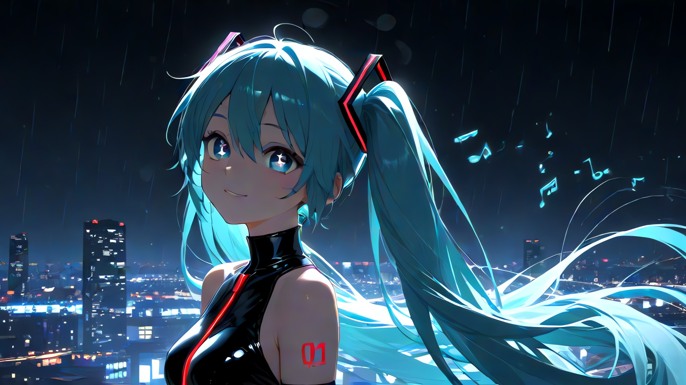
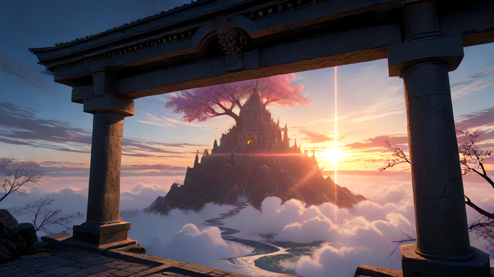
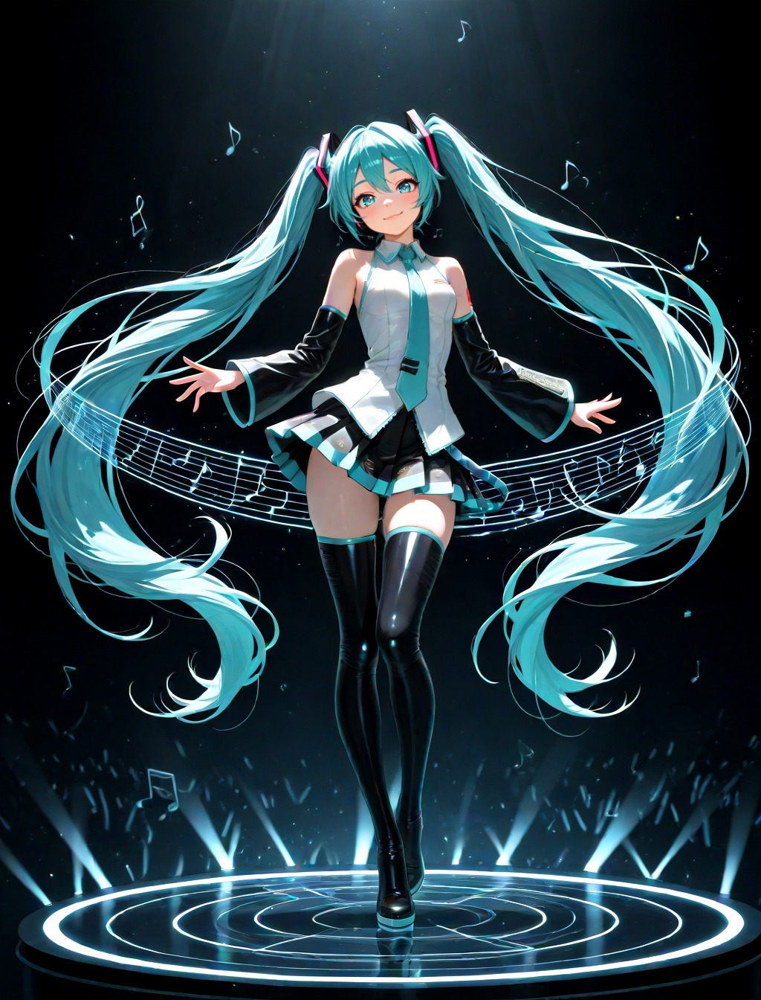
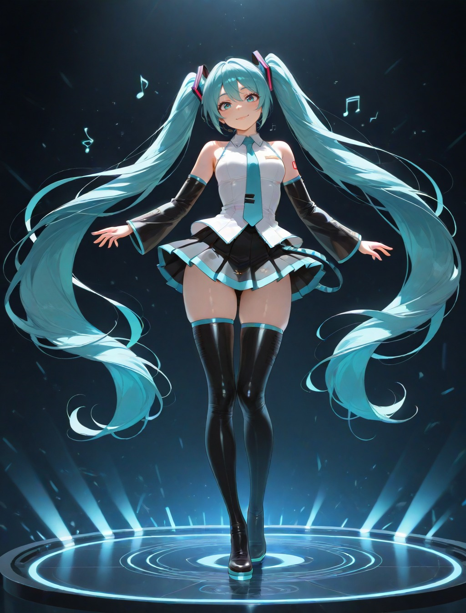
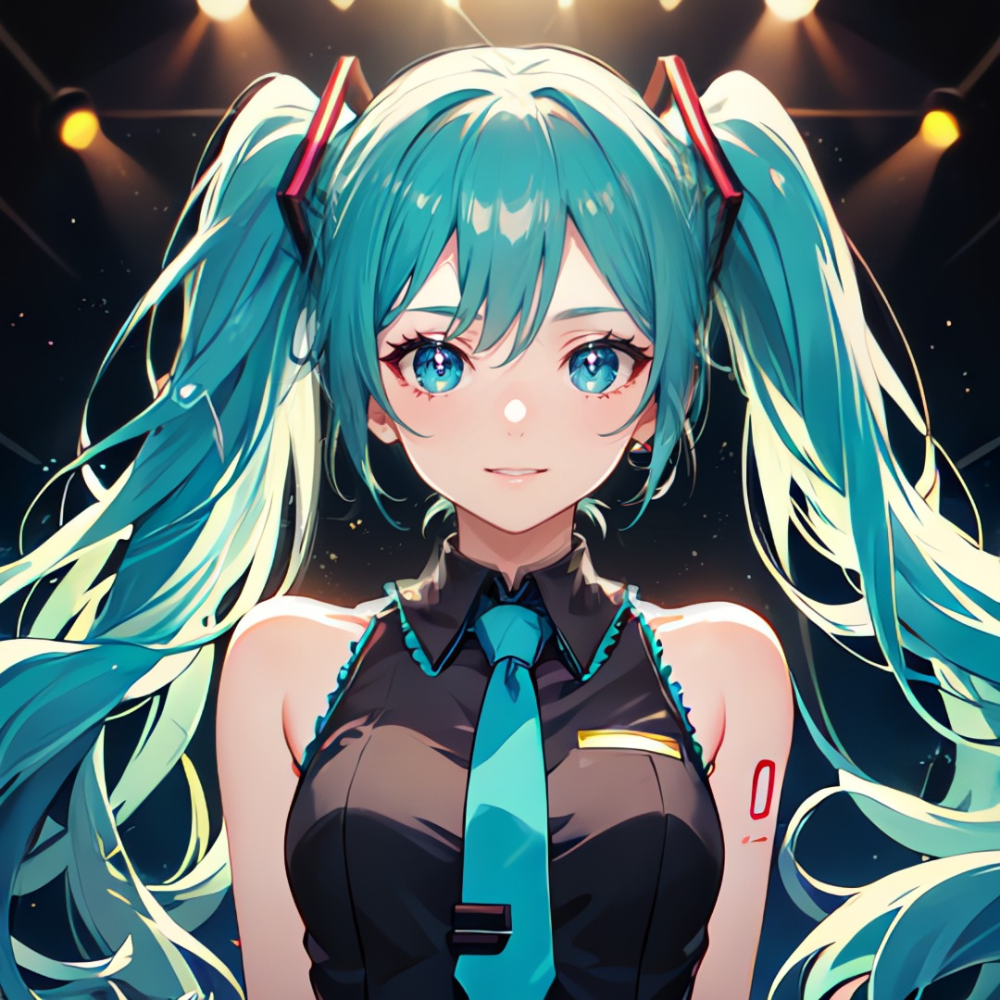
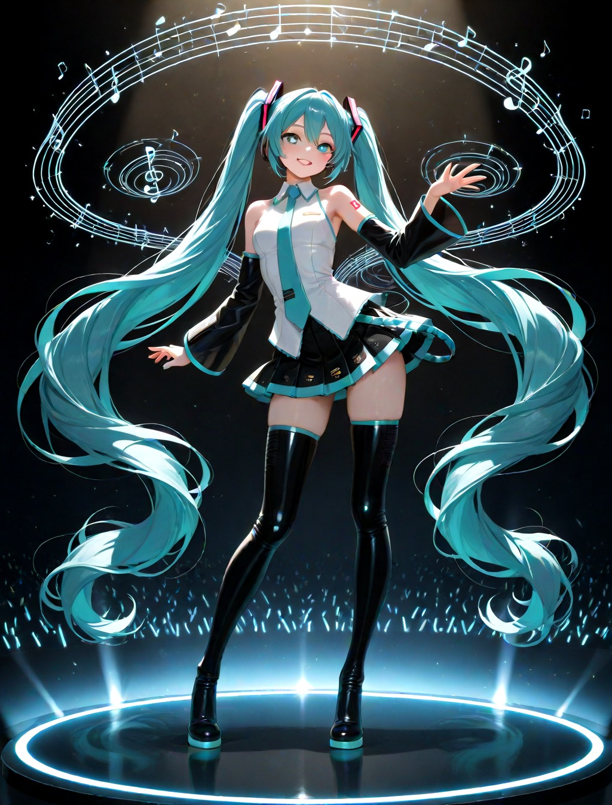
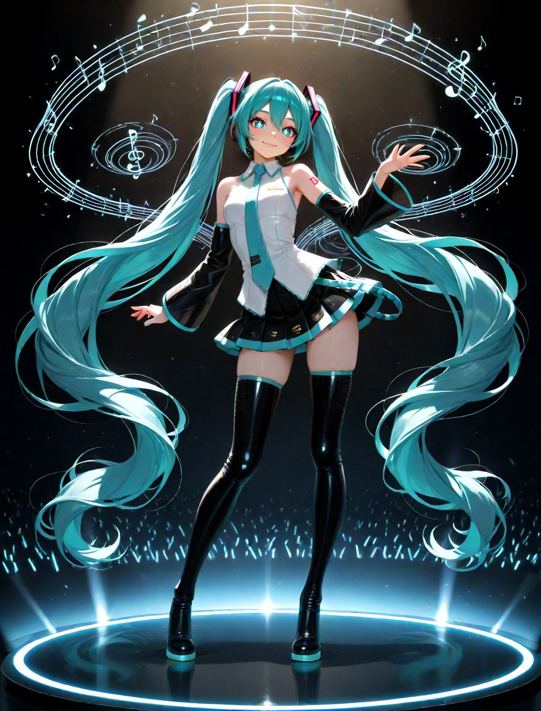
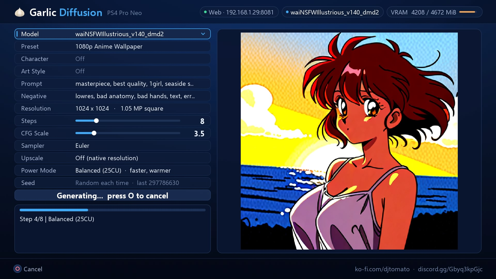
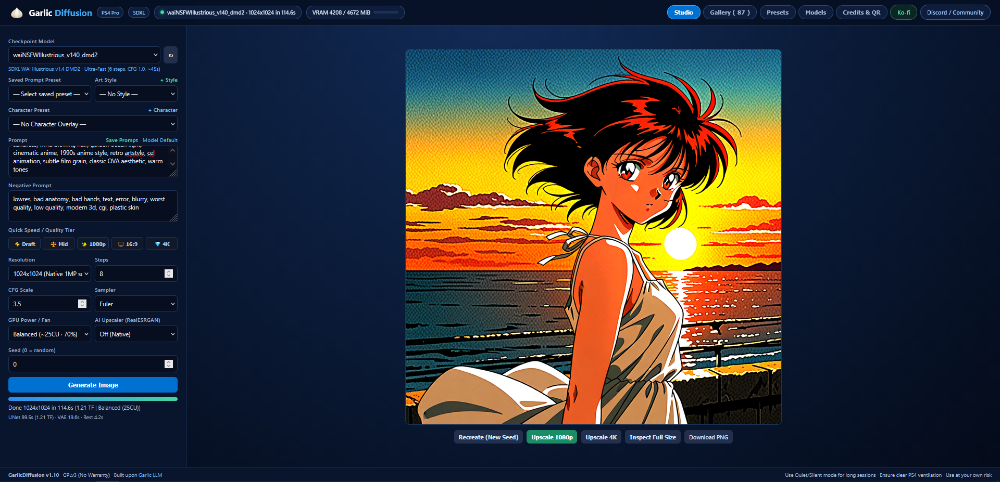

<p align="center"></p>

# GarlicDiffusion (`v1.17`)

**Native Stable Diffusion 1.5, SDXL & Real-ESRGAN 1080p/4K AI Upscaling running directly on a PlayStation 4 or PS4 Pro GPU. 100% offline, no PC required.**

[Website](https://djtomato.github.io/GarlicDiffusion/) · [Features](https://djtomato.github.io/GarlicDiffusion/features.html) · [Verified Models](https://djtomato.github.io/GarlicDiffusion/models.html) · [Scenic Gallery](https://djtomato.github.io/GarlicDiffusion/scenic.html) · [Technical Benchmarks](https://djtomato.github.io/GarlicDiffusion/benchmarks.html) · [Download PKG](https://github.com/DJTOMATO/GarlicDiffusion/releases/latest) · [Models (Hugging Face)](https://huggingface.co/DJTomato/ps4-diffusion-models) · [Support on Ko-fi](https://ko-fi.com/djtomato) · [Community & Discord](https://discord.gg/Gbyq3kpGjc)

---

## Real PS4 Pro Outputs (100% Console-Generated · `v1.16+`)

Every image below was rendered and AI-upscaled **100% locally on a PS4 Pro (FW 11.00, Neo Mode)** in **Quiet (20 CU)** mode using GarlicDiffusion's exact out-of-the-box presets — with standard Automatic1111 PNG Info metadata embedded inside every file:

| WAI-Illustrious v17 DMD2 · 16:9 Full HD `1920×1080` · 4 stp · LCM · **69.0s** | WAI-Illustrious v17 DMD2 · 16:9 Scenic `1920×1080` · 4 stp · LCM · **68.2s** |
| :---: | :---: |
|  |  |

| WAI-Illustrious v17 DMD2 · `1024×1344` + FaceFix · **170.0s** | Prefect Illustrious XL v2 DMD2 · `1024×1344` + FaceFix · **170.0s** | MeinaMix V11 (SD 1.5) · `512→1080p` + FaceFix · **154.0s** |
| :---: | :---: | :---: |
|  |  |  |

### Built-In Automatic Face & Eye Fix (ADetailer)

Full-body renders automatically detect anime faces, crop and re-render them at full latent resolution (`512×512` on SD 1.5 / `768×768` on SDXL), and blend crisp symmetric eyes back into the image with zero manual masking:

| Before — Auto Face Fix OFF (`1024×1344` · **120.7s** · Seed `611953`) | After — Auto Face Fix ON (`768×768` Crop Pass · **170.1s** · `+49.4s`) |
| :---: | :---: |
|  |  |

> Browse all verified checkpoints, scenic wallpapers, and full benchmarks on the [**Main Showcase**](https://djtomato.github.io/GarlicDiffusion/), [**Features**](https://djtomato.github.io/GarlicDiffusion/features.html), [**Verified Models**](https://djtomato.github.io/GarlicDiffusion/models.html), [**Scenic Gallery**](https://djtomato.github.io/GarlicDiffusion/scenic.html), and [**Hardware Benchmarks**](https://djtomato.github.io/GarlicDiffusion/benchmarks.html).

---

## Use It on Your PS4 TV — or From Any Browser

Control everything with a DualShock 4 directly on your TV (60 FPS non-blocking **Easy Mode** & **Advanced Studio**), or open **`http://<PS4_IP>:8081`** from any PC, phone, or tablet on your Wi-Fi:

| PS4 TV Studio (DualShock 4 Dropdowns & Sliders) | Browser Web Studio (`http://<PS4_IP>:8081`) |
| :---: | :---: |
|  |  |

---

## What It Does (`v1.17`)

| Feature | Details |
|---|---|
| **Dual SD 1.5 & SDXL GCN Engine** | 22 custom zero-scratch OpenCL GCN (`gfx701`) compute kernels dispatched via hand-written PM4 command buffers. Supports **LCM**, **Euler**, **Euler a**, and **DPM++ 2M Karras** samplers plus A1111 `(tag:weight)` prompt weighting, built-in **EasyNegative TI** on SD 1.5, and native `1024×1344` on SDXL (`~1.71 GiB` SD 1.5 / `~4.15 GiB` SDXL). |
| **Base PS4, PS4 Slim & PS4 Pro Neo** | Full **PS4 Pro Neo** mode (36 CUs, `4.67 GiB` GPU pool, up to `1024×1344`) and **Base / Slim PS4** support (18 CUs, automatic `325 MiB` compact scratch & `24×24` VAE tiles so both SD 1.5 and SDXL fit!). |
| **Auto Face & Eye Fix (ADetailer)** | Automatic anime face detection and high-res img2img crop pass (`vae_enc_sdxl` / `vae_enc_sd15` add-ons) plus offline Real-ESRGAN face-crop fallback — available automatically on render or post-render from the TV & Web Gallery. |
| **Zero-VRAM Kohya LoRA Fusion (22 LoRAs)** | Fuses Kohya `.safetensors` LoRAs directly into Q8_0 / FP16 weights with **0 MiB extra VRAM**. Stack inline `<lora:name:weight>`, use the paginated TV/Web LoRA Manager with sequential download queue, and rely on strict safetensors header inspection to prevent SD 1.5 ↔ SDXL mismatches. |
| **Built-In 1080p & 4K AI Upscaler** | Bundled **Real-ESRGAN AnimeVideo v3** (`SRVGGNetCompact`, 2.4 MiB) runs natively on the PS4 GPU — turning `512×512 → 1080×1080` in **7.3s**, `1024×576 → 1920×1080` in **17.1s**, or up to **4K UHD (`3840×2160`)** on PS4 Pro. |
| **Easy Mode, 290+ Characters & Randomizer** | Start creating in seconds with **Easy Mode** (**290+ anime & game characters**, **120+ curated scenes**, Hand/Eye Shield, Face Fix, and 1-click speed/quality tiers), a **500-word batch randomizer** with `{a\|b\|c}` wildcards, and **v1.17 Smart NSFW/SFW Prompt Conflict Sanitizer**. |
| **Active Hardware Thermal Guard** | 4 live CU power profiles (`Silent 14CU`, `Quiet 20CU`, `Balanced 25CU`, `Turbo 36CU` on Pro; `7 / 11 / 14 / 18 CU` on Base PS4) using `SH_STATIC_THREAD_MGMT` masks + real-time GoldHEN SoC temperature monitoring that steps down CUs at `80–84 °C` and cools at `86–88 °C`. |
| **Live Previews, Gallery Folders & OTA** | Instant CPU per-step latent previews (`<0.5 ms`), Gallery **Folders / Starred Favorites / ZIP Export**, **Full Settings Restore** ("Load to Studio" / "Re-Render Variation"), 1-click **Hugging Face HTTPS Downloader**, and **GitHub OTA PKG Updater**. |
| **A1111, OpenAI & Discord Bot API** | Full LAN Web Studio on port `8081`, Automatic1111 `tEXt` `"parameters"` PNG metadata, `/sdapi/v1/txt2img` (compatible with [`zhaobenny/bz-cogs/aimage`](https://github.com/zhaobenny/bz-cogs/tree/main/aimage) Discord bots), OpenAI `/v1/images/generations`, persisted **Silent API Power Mode**, and a **64-entry exact-request API cache**. |

---

## Hardware Benchmarks (Measured on PS4 Pro Neo, FW 11.00 · `v1.16+`)

### 1. Speed & Quality Tiers at a Glance (`Quiet Mode · 20 of 36 CUs · Live Thermal Telemetry`)

| Quality Tier | Resolution → Output | Steps / CFG / Sampler | SD 1.5 (`MeinaMix 8-Step` / `V11`) | SDXL (`WAI-Illustrious v17 DMD2`) | Use Case |
|---|---|---|---:|---:|---|
| **⚡ Testing Draft** | `512×512` (Native) | 4 steps · `Euler` / `LCM` | **28.4s** (`10.8s` UNet) | **30.8s** (`9.8s` UNet) | Quick composition & seed scouting |
| **⚖️ Speed / Base** | `512×512` / `768×1024` (Native) | 8 / 4 steps · Native | **43.6s** (`21.6s` UNet) | **67.1s** (`29.2s` UNet) | Fast clean portrait without upscaler |
| **✨ Crisp 1080p HD** | `512×512 → 1080×1080` | 8 steps + **1080p AI Up** | **50.9s** (`7.3s` Upscale) | — | Fast Base PS4 / Slim 1080p output |
| **🖥️ 16:9 Full HD** | `1024×576 → 1920×1080` | 4 steps + **1080p AI Up** | — | **68.0s–69.0s** (`17.1s` Upscale) | Widescreen desktop & TV wallpapers |
| **🎯 Native 1.38 MP** | `1024×1344` (Native) | 4 steps · `CFG 1.0` · `LCM` | — | **119.3s–120.7s** (no FaceFix) | Full-res SDXL landscapes & portraits |
| **💎 Flagship + FaceFix** | `512→1080p` / `1024×1344` | 8–20 / 4 steps + **Auto Face Fix** | **96.7s** (`8-step`) / **154.0s** (`20-step`) | **154.7s** (`Balanced`) / **170.0s** (`Quiet`) | Maximum eye/face & detail fidelity |
| **🐢 Non-DMD2 SDXL** | `1024×1344` + FaceFix | 8 stp (`Euler`) / 20 stp (`DPM++ 2M`) | — | **409.6s** (`8-step`) / **847.5s** (`20-step`) | Shows why DMD2 is **2.4×–5× faster** |

### 2. Selected Verified Benchmark Runs (`PS4 Pro Neo · v1.16`)

| Category / Model | Arch | Gen → Output | Settings | Power Mode | UNet | VAE | Upscale | FaceFix | **Total** | VRAM |
|---|---|---|---|---|---:|---:|---:|---:|---:|---:|
| **MeinaMix V11 8-Step** (Draft) | SD 1.5 | `512×512` | 4 stp · CFG 3.0 · `Euler` | Quiet (20 CU) | 10.8s | 13.0s | — | — | **28.4s** | 1,754 MiB |
| **WAI-Illustrious v17 DMD2** (Draft) | SDXL | `512×512` | 4 stp · CFG 1.0 · `LCM` | Quiet (20 CU) | 9.8s | 13.8s | — | — | **30.8s** | 4,250 MiB |
| **MeinaMix V11 8-Step** (Scenic 1080p) | SD 1.5 | `512×512 → 1080×1080` | 8 stp · CFG 3.5 · `Euler` | Quiet (20 CU) | 21.6s | 12.9s | **7.3s** | — | **50.9s** | 1,754 MiB |
| **WAI-Illustrious v17 DMD2** (Portrait) | SDXL | `768×1024` | 4 stp · CFG 1.0 · `LCM` | Quiet (20 CU) | 29.2s | 30.6s | — | — | **67.1s** | 4,250 MiB |
| **WAI v17 / v14 / Plant Milk** (16:9 HD) | SDXL | `1024×576 → 1920×1080` | 4 stp · CFG 1.0 · `LCM` | Quiet (20 CU) | 20.9–21.6s | 23.0s | **17.1s** | — | **68.0–69.0s** | 4,250 MiB |
| **MeinaMix V11 8-Step** (1080p + FF) | SD 1.5 | `512×512 → 1080×1080` | 8 stp · CFG 3.5 · `Euler` | Quiet (20 CU) | 21.6s | 12.9s | **7.3s** | **45.7s** | **96.7s** | 1,754 MiB |
| **MeinaMix V11 8-Step** (Silent + FF) | SD 1.5 | `512×512 → 1080×1080` | 8 stp · CFG 3.5 · `Euler` | **Silent (14 CU)** | 21.6s | 13.3s | **8.2s** | **49.0s** | **104.5s** | 1,754 MiB |
| **WAI-Illustrious v17 DMD2** (Native) | SDXL | `1024×1344` | 4 stp · CFG 1.0 · `LCM` | Quiet (20 CU) | 58.6–59.7s | 53.6s | — | — | **119.3–120.7s** | 4,250 MiB |
| **MeinaMix V11 / GhostMix V2 / Anything V5** | SD 1.5 | `512×512 → 1080×1080` | 20 stp · CFG 6.5 · `DPM++ 2M K` | Quiet (20 CU) | 53.9s | 13.0s | **7.3s** | **57.3s** | **154.0s** | 1,754 MiB |
| **WAI-Illustrious v17 DMD2** (Balanced) | SDXL | `1024×1344` | 4 stp · CFG 1.0 · `LCM` | **Balanced (25 CU)** | 55.3s | 53.6s | — | **39.5s** | **154.7s** | 4,250 MiB |
| **All Verified Illustrious DMD2 Models** | SDXL | `1024×1344` | 4 stp · CFG 1.0 · `LCM` | Quiet (20 CU) | 59.7s | 53.6s | — | **49.2s** | **169.9–170.0s** | 4,250 MiB |
| **WAI-Illustrious v17 DMD2** (Silent) | SDXL | `832×1216 → 1080×1578` | 4 stp · CFG 1.0 · `LCM` | **Silent (14 CU)** | 40.3s | 38.4s | **39.5s** | **51.6s** | **179.7s** | 4,250 MiB |
| **WAI-Illustrious v14 8-Step** (Hyper-SD) | SDXL | `1024×1344` | 8 stp · CFG 3.5 · `Euler` | Quiet (20 CU) | 236.7s | 53.6s | — | **91.2s** | **409.6s** | 4,250 MiB |
| **WAI-Illustrious v14 Full** (20-Step) | SDXL | `1024×1344` | 20 stp · CFG 6.0 · `DPM++ 2M K` | Quiet (20 CU) | 589.9s | 53.6s | — | **133.1s** | **847.5s** | 4,250 MiB |
| **Base PS4 / PS4 Slim (18 CU)** | SD 1.5 / SDXL | `512×512` / `768×1024` | 8 / 4 steps | Balanced (14 CU) | *TBD* | *TBD* | *TBD* | *TBD* | *[Submit Issue!](.github/ISSUE_TEMPLATE/benchmark_report.md)* | 1.54 / 4.04 GiB |

> See the full 30+ run matrix and GCN architecture breakdown on [**benchmarks.html**](https://djtomato.github.io/GarlicDiffusion/benchmarks.html).

### 3. Hardware CU Power Mode Micro-Benchmark (`gemm_q8 2304×1280×1280` on PS4 Pro Neo)

| Power Mode | Active CUs (PS4 Pro) | Active CUs (Base/Slim) | Measured Q8_0 GEMM | Relative Compute | Thermal & Fan Behavior |
|---|---:|---:|---:|---:|---|
| **Turbo** | 36 / 36 CUs | 18 / 18 CUs | **2.757 TFLOPS** | 100.0% | Peak speed; protected by Active Thermal Guard |
| **Balanced** | ~25 / 36 CUs | ~14 / 18 CUs *(Base default)* | **1.915 TFLOPS** | 69.5% | Moderate fan; 15ms inter-block breathers |
| **Quiet** *(Pro default)* | ~20 / 36 CUs | ~11 / 18 CUs | **1.613 TFLOPS** | 58.5% | Calm fan; 40ms inter-block breathers |
| **Silent** | ~14 / 36 CUs | ~7 / 18 CUs | **0.986 TFLOPS** | 35.8% | Whisper-quiet late-night & default API/Bot mode |

---

## Requirements & Install

### Requirements
- A **PS4, PS4 Slim, or PS4 Pro** running [GoldHEN](https://github.com/GoldHEN/GoldHEN) (tested on FW 11.00; compatible with 9.00–12.50+ homebrew setups).
- **1.2–3.7 GiB free HDD/SSD space** per installed checkpoint (SD 1.5: `~1.22 GiB` · SDXL: `~3.72 GiB` · VAE Encoder FaceFix add-ons: `130 MiB` each).

### Install in Three Steps
1. Download **`Garlic-Diffusion.pkg`** (`7.19 MiB`) from [**GitHub Releases**](https://github.com/DJTOMATO/GarlicDiffusion/releases/latest) and install it via *GoldHEN → Package Installer* (future updates can be installed in 1 click via the built-in **GitHub OTA Updater**).
2. Launch **GarlicDiffusion** from the PS4 home screen and pick **Easy Mode** or **Advanced Studio**.
3. **Download a model in 1 click right inside the app**:
   - Press **`[OPTIONS]`** on your DualShock 4 (or select **`Model → + Download / Manage Models`** with **`✕`**, or open `http://<PS4_IP>:8081` → **Models** tab) and download any verified checkpoint from [`DJTomato/ps4-diffusion-models`](https://huggingface.co/DJTomato/ps4-diffusion-models):
     - **SDXL DMD2 / Illustrious:** `WAI_Illustrious_v17_dmd2`, `Prefect_Illustrious_XL_v2_dmd2`, `Nova_Anime_XL_v18_dmd2`, `Hassaku_XL_v31_dmd2`, `Illustrious_Pencil_v32_dmd2`, `Plant_Milk_Walnut_dmd2`, `Obsession_Illustrious_v4_dmd2`, `waiNSFWIllustrious_v140_dmd2` (`+ 8-step & 20-step`)
     - **SD 1.5 (Ideal for Base PS4 / Slim):** `MeinaMix_V11_8step`, `MeinaMix_V11`, `GhostMix_V2`
     - **Recommended Add-ons:** `vae_enc_sdxl` & `vae_enc_sd15` (enables full img2img Auto Face Fix)

---

## PS4 Controller Controls (Dropdowns & Sliders UI)

| Button | Studio Action |
|---|---|
| **↑ / ↓** *(D-Pad or Left Stick)* | Navigate between Studio rows (`Model`, `Preset`, `Character`, `Art Style`, `Prompt`, `Negative`, `Resolution`, `Steps`, `CFG Scale`, `Sampler`, `Upscale`, `Power Mode`, `Seed`, `Generate`) |
| **✕ (Cross)** | **Open Dropdown** on choice rows, **Adjust Slider** on `Steps`/`CFG Scale`, **Open PS4 Keyboard** on `Prompt`/`Negative`/custom `Seed`, or **Generate** |
| **○ (Circle)** | **Close Dropdown** / **Cancel & Revert Slider** / **Cancel Active Generation** — or open **Credits & Scannable QR Codes** from idle Studio |
| **← / →** *(D-Pad or Left Stick)* | Directly cycle choice rows inline or adjust `Steps` (`4..40`) and `CFG Scale` (`1.0..15.0`) sliders (`L1/R1` for coarse steps or page jump inside dropdowns) |
| **△ (Triangle)** | **Generate Image** immediately from any row (composes active Character + Prompt + Art Style) |
| **□ (Square)** | Open **TV Image Gallery** (`←/→` browse, `R1` full-screen, `✕` Artwork Actions: Load to Studio, Re-Render Variation, **Fix Face**, Upscale 1080p, Move Folder) |
| **OPTIONS** | Open **Model & LoRA Manager** (Hugging Face HTTPS Downloader + Sequential LoRA Queue) |

---

## API & Discord Bot Integration (`port 8081`)

### Automatic1111 & Red-DiscordBot (`zhaobenny/bz-cogs/aimage`)
Point any Automatic1111 client or [`bz-cogs/aimage`](https://github.com/zhaobenny/bz-cogs/tree/main/aimage) Discord cog to `http://<PS4_IP>:8081`:
- `POST /sdapi/v1/txt2img` (supports `override_settings.sd_model_checkpoint`, `enable_hr: true`, `auto_face_fix: true`, `no_cache: true`, and automatic 64-entry exact-request caching)
- `GET /sdapi/v1/sd-models`, `/sdapi/v1/sd-modules`, `/sdapi/v1/samplers`, `/sdapi/v1/upscalers`, `/sdapi/v1/prompt-styles`, `/sdapi/v1/progress`, `/sdapi/v1/options`, `POST /sdapi/v1/interrupt`

### OpenAI-Compatible Image Endpoint
```bash
curl http://<PS4_IP>:8081/v1/images/generations \
  -H "Content-Type: application/json" \
  -d '{"prompt":"masterpiece, best quality, 1girl, hatsune miku, neon concert stage","size":"1024x1344"}'
```

---

## Convert Your Own Models & Build from Source

```bash
# Convert any SDXL checkpoint + optional DMD2 4-step LoRA into Q8_0 PSD1:
python pc/convert_sdxl.py frankjoshua/waiIllustriousSDXL_v170 WAI_Illustrious_v17_dmd2 \
  --arch sdxl --lora tianweiy/DMD2/dmd2_sdxl_4step_lora_fp16.safetensors --lora-scale 0.85

# Convert any SD 1.5 checkpoint + optional Hyper-SD 8-step LoRA:
python pc/convert_sdxl.py Meina/MeinaMix_V11 MeinaMix_V11_8step \
  --arch sd15 --lora ByteDance/Hyper-SD/Hyper-SD15-8steps-CFG-lora.safetensors --lora-scale 0.8

# Build the PS4 PKG (requires OpenOrbis PS4 Toolchain + Zig + .NET):
python build_diffusion.py
```

See [**CONTRIBUTING.md**](CONTRIBUTING.md) for host unit test instructions and PR guidelines, and [**CHANGELOG.md**](CHANGELOG.md) for full release notes.

---

## ⚠️ Hardware, Thermal & Liability Disclaimer

> **USE AT YOUR OWN RISK — NO WARRANTY ([GPLv3 §§ 15–16](LICENSE) · [Full Disclaimer](DISCLAIMER.md)):**
> GarlicDiffusion is provided **"AS IS"** without warranty of any kind. In no event shall the authors, contributors, or upstream copyright holders be liable for any console overheating, fan/APU wear, thermal shutdown, data loss, or hardware damage.
>
> **Thermal Care on Aging PS4 Consoles:** Diffusion inference drives sustained GPU compute load on 7–13 year old hardware. GarlicDiffusion includes real-time SoC temperature monitoring and an Active Thermal Guard, but you should always keep your PS4's vents unobstructed, maintain clean heatsinks/thermal paste, and stick to **Quiet (20 CU)** or **Silent (14 CU)** mode for long or unattended runs.

---

## Credits, Lineage & Licenses

**GarlicDiffusion**'s source code is licensed under the **[GNU General Public License v3.0 (GPLv3)](LICENSE)**.

This project is respectfully inspired by and builds upon **[Garlic LLM](https://github.com/leonardo-alegria/garlic-llm)** ([garlicllm.dev](https://garlicllm.dev)) by **[Leonardo Alegría](https://www.linkedin.com/in/leonardoalegria/)**, adapting its bare-metal PS4 GCN PM4 compute architecture, "Garlic" direct-memory pipeline, and UI renderer. Please consider supporting Leonardo's pioneering PS4 AI work on [his Ko-fi](https://ko-fi.com/leonardoalegria) alongside [GarlicDiffusion's Ko-fi](https://ko-fi.com/djtomato).

| Component | Author / Source | License |
|---|---|---|
| **GarlicDiffusion App & GCN Kernels** | DJTomato & Contributors | [GNU GPLv3](LICENSE) |
| **[Garlic LLM](https://github.com/leonardo-alegria/garlic-llm)** (Foundation & UI Renderer) | Leonardo Alegría ([garlicllm.dev](https://garlicllm.dev)) | GNU GPLv3 |
| **Stable Diffusion XL 1.0 & SD 1.5** | Stability AI / RunwayML | CreativeML Open RAIL++-M / RAIL-M |
| **WAI-Illustrious / Nova / Hassaku / Prefect / Pencil / Plant Milk / Obsession** | Illustrious Community / OnomaAI | Fair AI Public License 1.0-SD |
| **DMD2 & Hyper-SD Distillation LoRAs** | Tianwei Yin et al. (MIT) / ByteDance | MIT / CreativeML Open RAIL++-M |
| **MeinaMix V11 / GhostMix v2.0 / Anything V5** | Meina / GhostInShell / Community | CreativeML Open RAIL-M |
| **Real-ESRGAN AnimeVideo v3 (`SRVGGNetCompact`)** | Xintao Wang et al. | BSD-3-Clause |
| **OpenOrbis PS4 Toolchain** | OpenOrbis Team | GNU GPLv3 |
| **Selawik UI Font** | Microsoft Corporation | SIL Open Font License 1.1 |

See [**CREDITS.md**](CREDITS.md) for complete notices.

---

*Not affiliated with or endorsed by Sony Interactive Entertainment. PlayStation and PS4 are trademarks of their respective owners. Hatsune Miku is a trademark of Crypton Future Media, Inc.*
